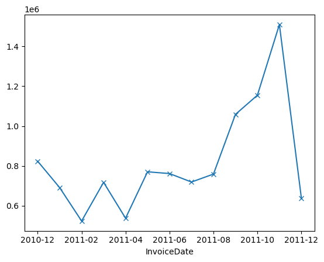
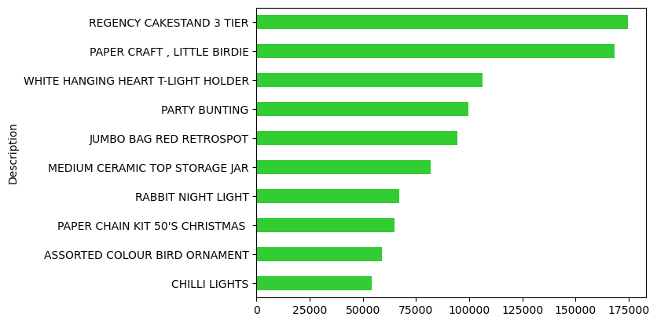
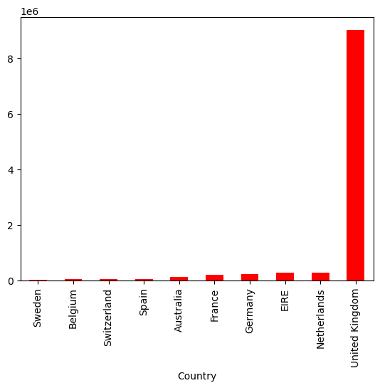

Project Overview

This project analyzes online retail transaction data to identify sales trends, top-performing products, and revenue distribution across countries. Using Python and Pandas, I cleaned and transformed the dataset, calculated revenue, and created visualizations to explore sales patterns. I also used SQLite and SQL to query the cleaned data and investigate transaction and customer metrics.

Dataset

The dataset was obtained from the UCI Machine Learning Repository's Online Retail dataset. It contains transactional data from a UK-based online retailer between December 2010 and December 2011.
Each record represents a product line within an invoice and includes information such as invoice number, product code, product description, quantity, invoice date, unit price, customer ID, and country. The dataset was used to analyze revenue trends, product performance, and sales distribution across countries.

Source: https://archive.ics.uci.edu/dataset/352/online+retail 

Tools Used - Python, Pandas, SQLite/SQL, Matplotlib.

Data Cleaning
Removed cancelled transactions, identified by invoice numbers beginning with "C" and negative quantities.
Removed records with a unit price of zero from the revenue analysis.
Converted invoice dates to datetime format to support time-based analysis.
Created a Revenue column by multiplying Quantity by UnitPrice.
Retained records with missing customer IDs because they were still useful for analyzing overall sales and revenue.
Excluded non-merchandise entries, such as postage and manual adjustments, from product-level rankings while retaining them in the underlying dataset.

Analysis
The analysis focused on the following questions:
How did revenue change over time?
Which products generated the most revenue?
How was revenue distributed across countries?

Python and Pandas were used for data cleaning, exploration, and visualization. SQL was used to query the cleaned dataset and examine transaction and customer metrics.

Key Findings
Revenue over time: Revenue tended to be lower during the earlier months of the year and into the summer, reaching a low of £523,631.89. Revenue then generally increased as the holiday season approached, peaking at £1,509,496.33 in November.
Product revenue: The Regency Cakestand and Paper Craft, Little Birdie products generated substantially more revenue than most of the other top-performing products. However, the revenue figures among the remaining top products were more closely grouped. The top 10 products accounted for 9.43% of total revenue.
Country performance: The United Kingdom generated substantially more revenue than any other country, contributing £9,025,222.08. The Netherlands ranked second, generating £285,446.34.

Methodology
Cleaned and analyzed the dataset using Python and Pandas.
Created visualizations using Matplotlib.
Loaded the cleaned data into SQLite and analyzed it using SQL.

Visualizations

